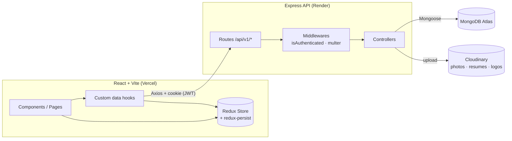
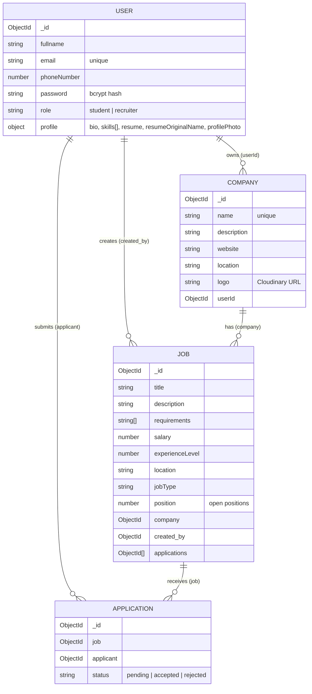
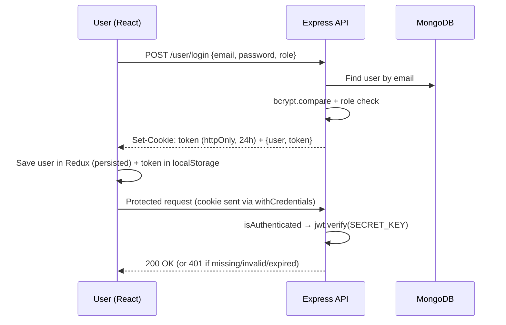

# 💼 JobPortal App (MERN Stack)

A full-stack job portal where **students** can search and apply for jobs, and **recruiters** can register companies, post jobs, and review/accept/reject applicants.

Built with **MongoDB, Express 5, React 18 (Vite), and Node.js**, styled with **Tailwind CSS + shadcn/ui (Radix)**, with state managed by **Redux Toolkit**.


---

## 📑 Table of Contents

1. [Live Demo](#-live-demo)
2. [Features](#-features)
3. [Tech Stack](#-tech-stack)
4. [Architecture](#-architecture)
5. [Project Structure](#-project-structure)
6. [Data Models](#-data-models)
7. [API Reference](#-api-reference)
8. [Frontend Routes](#-frontend-routes)
9. [Authentication Flow](#-authentication-flow)
10. [Getting Started](#-getting-started)
11. [Environment Variables](#-environment-variables)
12. [Available Scripts](#-available-scripts)
13. [Deployment](#-deployment)
14. [Known Limitations & Roadmap](#-known-limitations--roadmap)
15. [Contributing](#-contributing)
16. [License](#-license)

---

## 🔗 Live Demo

| Service  | URL |
|----------|-----|
| Frontend (Vercel) | https://jobportal-app-mern-client.vercel.app/ |
| Backend (Render)  | https://jobportal-app-mern-server.onrender.com/ |

> ℹ️ The backend may be on a free tier and take ~30–60 seconds to wake up on the first request.

---

## 🚀 Features

### 👨‍🎓 Student (Job Seeker)
- Sign up / log in (with optional profile photo upload)
- Browse the latest jobs on the home page and explore **category shortcuts** (Frontend, Backend, Data Science, Graphic Designer, FullStack)
- Search jobs by keyword from the hero search bar
- Filter jobs by **location**, **role/industry** and **salary range** on the Jobs page
- View full job details (company, salary, location, job type, experience, requirements, number of applicants)
- **One-click apply**, with duplicate applications blocked server-side
- Profile page with bio, skills, phone, and **resume upload** (stored on Cloudinary)
- Track **applied jobs** and their status (`pending` / `accepted` / `rejected`)

### 🏢 Recruiter (Employer)
- Register and manage **companies** (name, description, website, location, logo)
- **Post jobs** with title, description, requirements, salary, location, job type, experience level, and open positions
- View all jobs they posted along with application counts
- View **applicants** for each job (name, email, phone, resume link, date)
- **Accept or reject** applicants

### 🔐 Platform
- JWT authentication using **HTTP-only cookies** (with a `Bearer` header fallback)
- Role-based UI and protected recruiter routes
- Password hashing with **bcrypt** (12 rounds) and input validation (email, phone, strong password)
- Persistent login state via **redux-persist**
- Toast notifications (Sonner), animated UI (Framer Motion), responsive Tailwind design

---

## 🧰 Tech Stack

### Frontend (`/client`)
| Purpose | Library |
|---|---|
| UI framework | React 18 + Vite 5 |
| Routing | React Router DOM v6 |
| State management | Redux Toolkit, React-Redux, redux-persist |
| Styling | Tailwind CSS 3, `tailwindcss-animate`, `class-variance-authority`, `clsx`, `tailwind-merge` |
| UI components | shadcn/ui built on Radix UI (Avatar, Dialog, Popover, Radio Group, Select, Label) |
| Icons / UX | lucide-react, Sonner (toasts), Framer Motion, Embla Carousel |
| HTTP client | Axios |
| Linting | ESLint 8 |

### Backend (`/server`)
| Purpose | Library |
|---|---|
| Runtime / framework | Node.js (ES Modules) + Express 5 |
| Database | MongoDB + Mongoose 8 |
| Auth | jsonwebtoken, bcryptjs, cookie-parser |
| File uploads | Multer (memory storage) → Data URI → Cloudinary |
| Utilities | cors, dotenv, nodemon |
| Installed (ready to use) | helmet, compression, morgan, express-rate-limit |

### Hosting
- **Frontend:** Vercel (SPA rewrite config included)
- **Backend:** Render / Vercel (`vercel.json` included)
- **Database:** MongoDB Atlas
- **Media storage:** Cloudinary

---

## 🏗 Architecture



**Request lifecycle (example: apply for a job)**

1. Student clicks **Apply**, and React calls `GET /api/v1/application/apply/:jobId` (with cookie).
2. `isAuthenticated` verifies the JWT and attaches `req.id`.
3. The controller checks for a duplicate application and that the job exists.
4. An `Application` document is created and its `_id` is pushed into `job.applications`.
5. The UI updates instantly via Redux and shows a success toast.

---

## 📁 Project Structure

```
JobPortal-App-MERN/
├── client/                         # React (Vite) frontend
│   ├── public/
│   ├── src/
│   │   ├── components/
│   │   │   ├── admin/              # Recruiter pages (companies, jobs, applicants)
│   │   │   │   ├── Companies.jsx · CompanyCreate.jsx · CompanySetup.jsx
│   │   │   │   ├── AdminJobs.jsx · PostJob.jsx
│   │   │   │   ├── Applicants.jsx · ApplicantsTable.jsx
│   │   │   │   └── ProtectedRoute.jsx
│   │   │   ├── auth/               # Login.jsx · Signup.jsx
│   │   │   ├── shared/             # Navbar.jsx · Footer.jsx
│   │   │   ├── ui/                 # shadcn/ui primitives (button, dialog, table…)
│   │   │   ├── Home.jsx · HeroSection.jsx · CategoryCarousel.jsx
│   │   │   ├── Jobs.jsx · Browse.jsx · FilterCard.jsx
│   │   │   ├── Job.jsx · LatestJobs.jsx · LatestJobCards.jsx
│   │   │   ├── JobDescription.jsx
│   │   │   └── Profile.jsx · UpdateProfileDialog.jsx · AppliedJobTable.jsx
│   │   ├── hooks/                  # useGetAllJobs, useGetAllAdminJobs, useGetAllCompanies,
│   │   │                           # useGetAppliedJobs, useGetCompanyById
│   │   ├── redux/                  # store.js + auth / job / company / application slices
│   │   ├── utils/                  # constant.js (API endpoints)
│   │   ├── lib/utils.js            # cn() class-name helper
│   │   ├── App.jsx                 # Router configuration
│   │   └── main.jsx                # App entry (Provider + PersistGate + Toaster)
│   ├── components.json             # shadcn/ui config
│   ├── tailwind.config.js · postcss.config.js · vite.config.js
│   └── vercel.json                 # SPA rewrites
│
└── server/                         # Node.js + Express backend
    ├── controllers/                # user · company · job · application logic
    ├── middlewares/
    │   ├── isAuthenticated.js      # JWT verification (cookie or Bearer token)
    │   └── mutler.js               # Multer single-file upload (memory storage)
    ├── models/                     # User · Company · Job · Application (Mongoose)
    ├── routes/                     # user.route · company.route · job.route · application.route
    ├── utils/
    │   ├── db.js                   # MongoDB connection
    │   ├── cloudinary.js           # Cloudinary config
    │   └── datauri.js              # Buffer → Data URI converter
    ├── server.js                   # App entry point
    └── vercel.json                 # Serverless deployment config
```

---

## 🗃 Data Models



All collections use Mongoose `timestamps` (`createdAt`, `updatedAt`).

---

## 📡 API Reference

**Base URL:** `{BACKEND_URL}/api/v1`
Routes marked 🔒 require authentication (JWT cookie or `Authorization: Bearer <token>`).

### 👤 User: `/user`
| Method | Endpoint | Auth | Description |
|---|---|---|---|
| POST | `/register` | – | Register a user (`multipart/form-data`: `fullname`, `email`, `phoneNumber`, `password`, `role`, optional `file` = profile photo) |
| POST | `/login` | – | Log in with `email`, `password`, `role`; sets HTTP-only cookie and returns `token` |
| GET | `/logout` | – | Clears the auth cookie |
| POST | `/profile/update` | 🔒 | Update `fullname`, `email`, `phoneNumber`, `bio`, `skills` (comma-separated), optional `file` = resume |

### 🏢 Company: `/company`
| Method | Endpoint | Auth | Description |
|---|---|---|---|
| POST | `/register` | 🔒 | Create a company (`companyName`) |
| GET | `/get` | 🔒 | List companies owned by the logged-in user |
| GET | `/get/:id` | 🔒 | Get a company by ID |
| PUT | `/update/:id` | 🔒 | Update `name`, `description`, `website`, `location`, optional `file` = logo |

### 💼 Job: `/job`
| Method | Endpoint | Auth | Description |
|---|---|---|---|
| POST | `/post` | 🔒 | Create a job |
| GET | `/get?keyword=&page=&limit=` | 🔒 | List jobs (keyword search on title/description, paginated, default `limit=10`) |
| GET | `/get/:id` | 🔒 | Job details with populated company and applications |
| GET | `/getadminjobs?page=&limit=` | 🔒 | Jobs created by the logged-in recruiter, with `applicationCount` |

**`POST /job/post` body**
```json
{
  "title": "Frontend Developer",
  "description": "Build amazing UIs with React.",
  "requirements": "React, JavaScript, Tailwind",
  "salary": 600000,
  "location": "Bangalore",
  "jobType": "Full-time",
  "experience": 2,
  "position": "3",
  "companyId": "<company ObjectId>"
}
```
`requirements` can be a comma-separated string or an array.

### 📝 Application: `/application`
| Method | Endpoint | Auth | Description |
|---|---|---|---|
| GET | `/apply/:id` | 🔒 | Apply to job `:id` (blocks duplicates) |
| GET | `/get` | 🔒 | Jobs the current user applied to (with job + company populated) |
| GET | `/:id/applicants` | 🔒 | Applicants of job `:id` |
| POST | `/status/:id/update` | 🔒 | Update application status (`{ "status": "accepted" \| "rejected" }`) |

### Standard response shape
```json
{ "success": true, "message": "…", "...data": "…" }
```
Errors return `success: false` with a `message` and an appropriate HTTP status (400/401/404/408/409/500/503).

---

## 🧭 Frontend Routes

| Path | Page | Access |
|---|---|---|
| `/` | Home (hero, categories, latest jobs) | Public UI |
| `/login`, `/signup` | Authentication | Public |
| `/jobs` | Job listing with filter sidebar | Logged-in (API requires auth) |
| `/browse` | Search results | Logged-in |
| `/description/:id` | Job details + Apply | Logged-in |
| `/profile` | Student profile, resume, applied jobs | Student |
| `/admin/companies` | Recruiter's companies | Recruiter |
| `/admin/companies/create` | Register a company | Recruiter |
| `/admin/companies/:id` | Edit company / upload logo | Recruiter |
| `/admin/jobs` | Recruiter's posted jobs | Recruiter |
| `/admin/jobs/create` | Post a new job | Recruiter |
| `/admin/jobs/:id/applicants` | Review applicants | Recruiter |

`/admin/*` routes are wrapped in `ProtectedRoute`, which redirects anyone who isn't a `recruiter` to `/`.

---

## 🔑 Authentication Flow



- Token lifetime: **24 hours**
- Cookie: `httpOnly`; `secure` + `sameSite: none` in production, `sameSite: strict` in development
- Password rule: min 8 characters with uppercase, lowercase and a number

---

## ⚙️ Getting Started

### Prerequisites
- **Node.js** ≥ 18
- **npm** or **yarn**
- A **MongoDB** database (local or [MongoDB Atlas](https://www.mongodb.com/atlas))
- A free **[Cloudinary](https://cloudinary.com/)** account (for image/resume uploads)

### 1. Clone the repository
```bash
git clone https://github.com/Ayush-verma25/JobPortal-App-MERN.git
cd JobPortal-App-MERN
```

### 2. Set up the backend
```bash
cd server
npm install          # or: yarn
```
Create `server/.env` (see [Environment Variables](#-environment-variables)), then:
```bash
npm run server       # development (nodemon)
# or
npm start            # production
```
The API runs at **http://localhost:8000** and `GET /` returns `API Working`.

### 3. Set up the frontend
Open a second terminal:
```bash
cd client
npm install          # or: yarn
```
Create `client/.env`:
```env
VITE_BACKEND_URL=http://localhost:8000
```
Then start the dev server:
```bash
npm run dev
```
The app runs at **http://localhost:5173**.

---

## 🔐 Environment Variables

### Backend: `server/.env`
```env
PORT=8000
MONGODB_URI=mongodb+srv://<user>:<password>@<cluster>.mongodb.net/jobportal
SECRET_KEY=your_long_random_jwt_secret

# Cloudinary
CLOUD_NAME=your_cloudinary_cloud_name
API_KEY=your_cloudinary_api_key
API_SECRET=your_cloudinary_api_secret

# CORS: must exactly match your frontend origin (no trailing slash)
VITE_FRONTEND_URL=http://localhost:5173

# Set to "production" when deployed (enables secure, cross-site cookies)
NODE_ENV=development
```

### Frontend: `client/.env`
```env
# Backend base URL WITHOUT /api/v1 (the app appends it)
VITE_BACKEND_URL=http://localhost:8000
```

> ⚠️ Never commit `.env` files. Both `.gitignore` files already exclude them.

---

## 📜 Available Scripts

### Backend (`/server`)
| Command | Description |
|---|---|
| `npm run server` | Start with **nodemon** (auto-reload) |
| `npm start` | Start with Node |

### Frontend (`/client`)
| Command | Description |
|---|---|
| `npm run dev` | Start Vite dev server |
| `npm run build` | Production build to `dist/` |
| `npm run preview` | Preview the production build |
| `npm run lint` | Run ESLint |

---

## ☁️ Deployment

**Frontend → Vercel**
1. Import the repo and set the **root directory** to `client`.
2. Add env var `VITE_BACKEND_URL` = your deployed backend URL.
3. `client/vercel.json` rewrites all routes to `/` so React Router works on refresh.

**Backend → Render (or Vercel)**
1. Create a Web Service with **root directory** `server`, build command `npm install`, start command `npm start`.
2. Add all backend environment variables, including `NODE_ENV=production` and `VITE_FRONTEND_URL` = your Vercel URL.
3. `server/vercel.json` is included if you prefer deploying the API as a Vercel serverless function.

Because the frontend and backend live on different domains, cookies use `SameSite=None; Secure` in production. The login flow also stores the token in `localStorage` as a fallback.

---

## 🛠 Known Limitations & Roadmap

Notes from reviewing the code, and good first issues for contributors:

**Security & authorization**
- [ ] Enforce **role checks on the server** (e.g., only recruiters can post jobs/update application status; only students can apply). Currently, most routes only check "is logged in".
- [ ] Verify **ownership** (a recruiter should only view applicants/update statuses for their own jobs, and only edit their own companies).
- [ ] Wire up the already-installed **helmet**, **express-rate-limit**, **compression** and **morgan** in `server.js`.
- [ ] Replace JWT `issuer` / `audience` placeholders (`"your-app-name"`, `"your-app-users"`) with real values.
- [ ] Add file-type and size limits to Multer uploads.

**Bugs / consistency**
- [ ] `register` validation accepts the role `admin`, but the `User` schema only allows `student` and `recruiter`.
- [ ] `getApplicants` returns `succees` (typo) instead of `success`.
- [ ] Several application controllers don't send an error response in their `catch` blocks.
- [ ] `client/src/utils/axiosConfig.js` is not imported anywhere and references `process.env.REACT_BACKEND_URL`, which doesn't work in Vite. Either use `import.meta.env.VITE_BACKEND_URL` or remove it.

**Features & UX**
- [ ] The client calls `GET /job/get` without `page`/`limit`, so only the first **10 jobs** are returned. Add pagination or infinite scroll in the UI.
- [ ] Sidebar filters (location / industry / salary) do a plain text match on the client. Implement real server-side filters (salary range, location, job type, experience).
- [ ] Make public job listing accessible without login.
- [ ] Add edit/delete for jobs and companies.
- [ ] Email notifications on application status changes.
- [ ] Add automated tests (Jest + Supertest for the API, Vitest + React Testing Library for the UI).
- [ ] Add a `.env.example` for both apps and a Dockerfile / docker-compose setup.

---

## 🤝 Contributing

1. Fork the repository
2. Create a feature branch: `git checkout -b feature/amazing-feature`
3. Commit your changes: `git commit -m "feat: add amazing feature"`
4. Push to the branch: `git push origin feature/amazing-feature`
5. Open a Pull Request

---

## 📄 License

Distributed under the **MIT License**. See `LICENSE` for more information.

---

## 👨‍💻 Author

**Ayush Verma** · [@Ayush-verma25](https://github.com/Ayush-verma25)

⭐ If you found this project helpful, please consider giving it a star!
